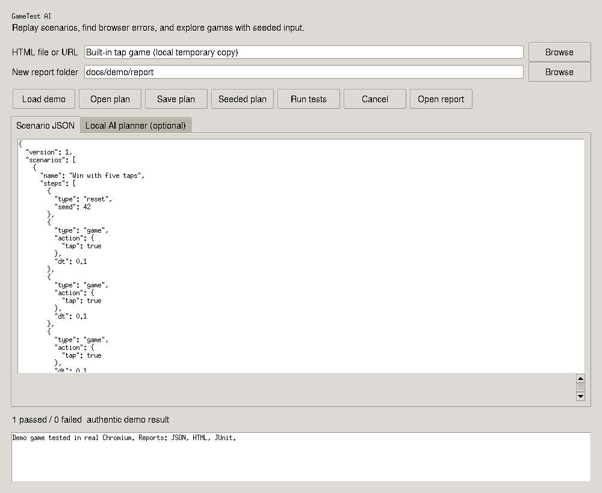

# GameTest AI

[](https://github.com/dhawiaymen/gametest-ai/actions/workflows/ci.yml)




**Reproducible browser-game testing, with an optional local AI scenario planner.**

GameTest AI is a Windows-oriented test workbench for HTML mini-games. It runs
data-only scenarios in real Chromium, checks assertions, catches browser errors,
and writes JSON, HTML, JUnit XML, and screenshots. A seeded input explorer tests
Canvas games through a small adapter. Optional Ollama integration generates
draft scenarios from a game description.

Version **0.1.0**, initial public version. MIT licensed. No paid API is
required. The deterministic runner and fuzz explorer are **not machine learning**;
the AI feature is the optional model-based planner, not a claim of autonomous
visual understanding or guaranteed bug detection.

## Portable Windows download

Use Windows 11+ x64 or Windows Server 2019+. Current Playwright does not list Windows 10 as a supported target; see [Windows requirements](docs/WINDOWS.md).

Open [Releases](https://github.com/dhawiaymen/gametest-ai/releases) and download the
`gametest-ai-0.1.0-windows-x64.zip` asset when the verified release is available.
Extract **the whole archive**, then launch `GameTestAI/GameTestAI.exe`. Do not run it inside
the ZIP or move only the EXE. The application is unsigned. No administrator
rights or paid account is needed. Keep the bundled `licenses/` folder.

The portable build includes its matching Chromium browser; Python and a separate browser download are not required. Ollama and model weights remain optional and are not bundled.

See [Windows help](docs/WINDOWS.md), [troubleshooting](docs/TROUBLESHOOTING.md),
[real demonstrations](docs/DEMO.md), and the [public roadmap](ROADMAP.md).

## Windows installation

Install **Python 3.11+** with Tcl/Tk and the Python launcher. Extract the project,
double-click **`Setup.cmd`**, then **`Start.cmd`**. Setup creates `.venv`, installs
Playwright, and downloads Chromium. Browser downloads may be several hundred MB.

Manual PowerShell installation:

```powershell
py -3 -m venv .venv
.\.venv\Scripts\python.exe -m pip install -e .
.\.venv\Scripts\python.exe -m playwright install chromium
.\.venv\Scripts\python.exe -m gametest_ai gui
```

If Chromium is missing, rerun its install command from the **same environment**.
For a managed Chromium installation, set `GAMETEST_BROWSER_PATH` to its executable.
The browser must be compatible with Playwright. Local tests need no online service.

## Run the included game

```powershell
python -m gametest_ai run examples/demo-game examples/tap-win.json --output reports/tap
python -m gametest_ai fuzz examples/demo-game --seed 42 --steps 300 --output reports/fuzz
python -m gametest_ai validate examples/tap-win.json
```

Open `reports/tap/report.html`. Every scenario gets a fresh browser context.
Reports also include the exact plan for replay. Each run requires a new output
folder. Exit codes: **0** all passed, **1** one or more failed, **2** setup or
input error. Failed assertions intentionally appear as failures, not successes.

Use **Load demo** for a bundled playable game and a passing plan.

In the GUI, choose an HTML file (or enter a URL), choose a new report folder,
load a JSON plan, and click **Run tests**. The log stays responsive. **Cancel**
takes effect between steps; locator operations and asynchronous adapter promises use the configured timeout. A synchronous infinite JavaScript loop can still hang Chromium; only test trusted games.

## What can be tested?

| Target | Supported behavior |
|---|---|
| HTML / DOM game | Click selectors, press keys, wait, assert element text, catch JS/console/request errors |
| Canvas game with GameTest adapter | All above plus deterministic reset/step, state assertions, seeded input, state invariants |
| GameScript Studio export | Adapter included; local files automatically run with `?test=1` |
| Native Windows / Unity / Roblox / TikTok app | Not supported in this release |

Adapters expose version 1, `reset(seed)`, `step(action, dt)`, and `snapshot()`.
State must include numeric `score`, `time`, `lives`, and status `running`, `won`,
or `lost`. `time` and `lives` cannot be negative. GameTest checks these after
every reset and game step. Other engines can implement the small contract in
[`docs/ADAPTER.md`](docs/ADAPTER.md). Remote URLs must explicitly enable their
own deterministic mode, e.g. `https://your-game.example/?test=1`.

## Optional local AI planner

Install [Ollama](https://ollama.com/) separately and download a compatible model
that fits your hardware and license requirements. For example, with a locally
available `qwen2.5-coder:7b` model:

```powershell
ollama pull qwen2.5-coder:7b
python -m gametest_ai generate examples/game-description.txt --model qwen2.5-coder:7b --output draft-plan.json
python -m gametest_ai validate draft-plan.json
```

The planner sends your description only to a local Ollama endpoint (default
`http://127.0.0.1:11434`). It requests JSON, validates it against the same bounded
schema as handwritten tests, and saves a draft. It does **not** run that draft.
Review its assumptions and assertions before running: syntactically valid model
output can still describe incorrect expectations. No model weights are bundled.
The automated tests exercise the HTTP adapter with a local stub; this does not
claim measured quality for a real language model.

## Test plan example

```json
{"version":1,"scenarios":[{"name":"Initial state","steps":[
  {"type":"reset","seed":42},
  {"type":"assert","source":"snapshot","path":"score","op":"eq","value":0}
]}]}
```

Supported step fields and limits are documented in [`docs/PLANS.md`](docs/PLANS.md).
There is no arbitrary JavaScript, Python, shell command, or URL-navigation step.

## Development and build

```powershell
python -m pip install -e ".[dev]"
python -m playwright install chromium
python -m pytest
python -m ruff check .
python -m build
powershell -ExecutionPolicy Bypass -File scripts/build_windows.ps1
```

The full suite includes actual browser pass/fail scenarios, input handling,
runtime-error detection, server path isolation, reporting, and AI response
validation. GUI tests require a display. CI targets Windows/Ubuntu and Python
3.11–3.13. See [executed validation](docs/VALIDATION.md) and [Windows distribution](docs/WINDOWS.md). See [`docs/WINDOWS.md`](docs/WINDOWS.md) for distribution.

## Limits, network, and privacy

Only games you are authorized to test should be run. No existing browser profile
or login session is used. External HTTP origins and upstream WebSocket connections are blocked by default; use
`run --allow-external` for authorized CDN-dependent games. This is not a hostile
content sandbox: Chromium is the isolation boundary, and games can still make
same-origin requests. Local games are served temporarily on loopback only;
directory listings and symlinks escaping the root are blocked.

Browser errors, console errors, and failed requests cause scenario failure.
Screenshot differences, FPS benchmarking, visual AI, accessibility audits,
adaptive reinforcement learning, and coverage measurement are not implemented.
Fuzzing is reproducible random input, not exhaustive exploration. Screenshots
and reports can contain game content and local paths; review them before sharing.
No reports are uploaded automatically. Scenarios are bounded to 120 seconds
between steps, with a default 5-second timeout for navigation, locators and asynchronous adapter promises. This is not a hard process deadline for synchronous JavaScript.

## Contributing / license

See [CONTRIBUTING.md](CONTRIBUTING.md), [SECURITY.md](SECURITY.md), and
[LICENSE](LICENSE). Maintainer: [dhawiaymen](https://github.com/dhawiaymen).
This implementation was AI-assisted; no adoption or external usage is claimed.

## Community

Report reproducible bugs through [Issues](https://github.com/dhawiaymen/gametest-ai/issues),
read the [contribution guide](CONTRIBUTING.md), and discuss proposals in
[Discussions](https://github.com/dhawiaymen/gametest-ai/discussions) when enabled.
Please follow our [Code of Conduct](CODE_OF_CONDUCT.md).
